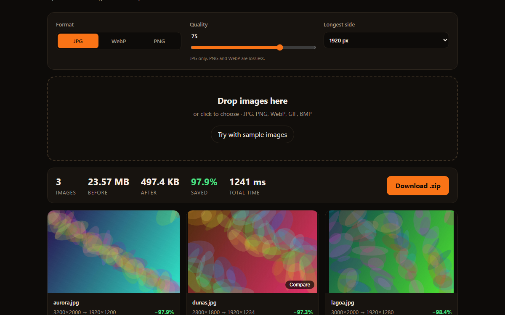
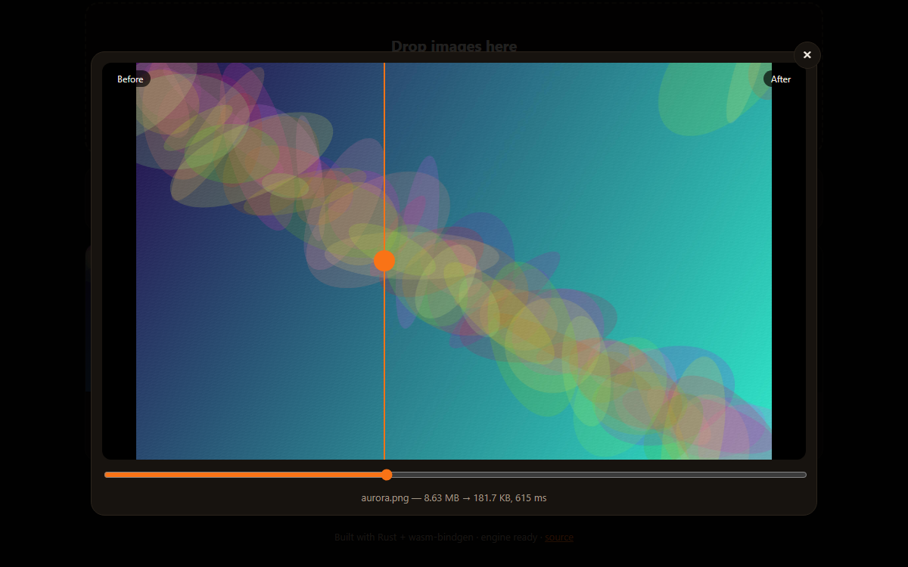

# PixelForge

**Image compressor and converter written in Rust, compiled to WebAssembly. Runs 100% in your browser, nothing is uploaded.**
**Compressor e conversor de imagens em Rust, compilado para WebAssembly. Roda 100% no navegador, nada é enviado.**

**[Live demo / Demo online](https://alissonlittig.github.io/pixelforge-wasm/)**





---

## English

Drop a batch of images, choose JPG, WebP or PNG, cap the longest side, and see time and percentage saved per file. Open any result in a before/after slider, then download everything as a single `.zip`.

- Decode (JPG, PNG, WebP, GIF, BMP), Lanczos3 resize, encode: all in Rust (`image` crate), compiled to a ~700 KB `.wasm`.
- ZIP is also built in Rust (`zip` crate), so the JS side is just UI.
- Files are read with the File API and never sent anywhere. There is no backend.
- JPG has adjustable quality. PNG and WebP are encoded **lossless** (the pure-Rust WebP encoder has no lossy mode), so savings there come mainly from resizing.
- Transparent images converted to JPG are flattened onto white.

### Run it

```bash
rustup target add wasm32-unknown-unknown
npm i -g wasm-pack            # or: cargo install wasm-pack
wasm-pack build --target web --release --out-dir docs/pkg
python -m http.server -d docs 8000   # open http://localhost:8000
cargo test                    # core tests (native)
```

On Windows without Visual Studio, `wasm-pack` may fail linking build scripts; point `LIB` at your MSVC/SDK libs.

### Stack
Rust · wasm-bindgen · wasm-pack · `image` · `zip` · vanilla JS/CSS · GitHub Pages

---

## Português

Arraste várias imagens, escolha JPG, WebP ou PNG, limite o lado maior e veja tempo e % economizada por arquivo. Abra qualquer resultado num slider antes/depois e baixe tudo num `.zip`.

- Decodificação, redimensionamento (Lanczos3) e codificação em Rust (crate `image`), num `.wasm` de ~700 KB.
- O ZIP também é gerado em Rust; o JS cuida só da interface.
- Os arquivos são lidos pelo navegador e nunca saem do aparelho. Não existe servidor.
- JPG tem qualidade ajustável. PNG e WebP saem **sem perdas** (o codificador WebP em Rust puro não tem modo com perdas), então a economia vem principalmente do redimensionamento.
- Imagens com transparência convertidas para JPG ficam sobre fundo branco.

### Como rodar

```bash
rustup target add wasm32-unknown-unknown
npm i -g wasm-pack
wasm-pack build --target web --release --out-dir docs/pkg
python -m http.server -d docs 8000   # abra http://localhost:8000
cargo test
```

### Stack
Rust · wasm-bindgen · wasm-pack · `image` · `zip` · JS/CSS puro · GitHub Pages

## License
MIT
